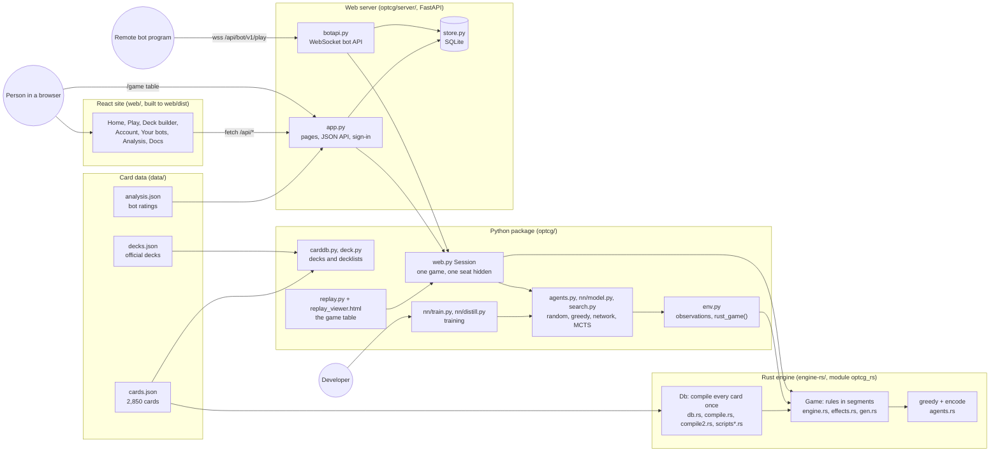
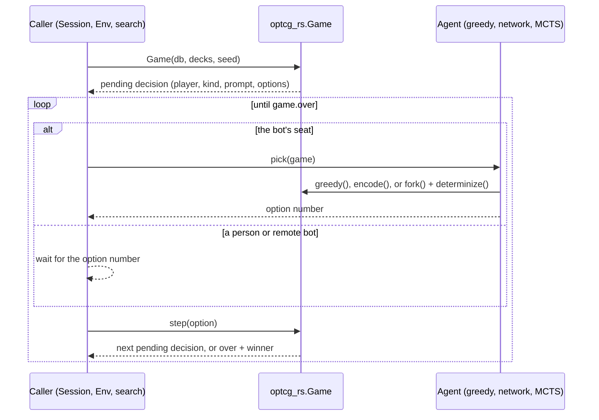

# Architecture

How the `optcg-bot` project fits together: a ONE PIECE CARD GAME rules engine (in Rust, with the
original Python engine kept alongside it), bots that play it (rules, neural networks, search),
and a website where people and programs play those bots.

Every diagram and table here is taken from the code. When the code changes, the file named
next to each diagram is the one to check.

| Page | What it covers |
|---|---|
| [Rust engine](engine.md) | `engine-rs/`: the game loop in segments, decisions and options, effects, the PyO3 bindings, the greedy agent and network encoding, the lethal search |
| [Card compiler](compiler.md) | How a card's printed text becomes runnable effects: `compile.rs`, `compile2.rs`, `gen.rs`, `scripts*.rs` |
| [Python package](python.md) | `optcg/`: card data and decks, the training environment, playing, training (imitation, PPO, distillation), MCTS with determinization |
| [Web server](server.md) | `optcg/server/`: browser games, sign-in, accounts, bots and API keys, the WebSocket bot API, with sequence diagrams for the happy and unhappy paths |
| [Database](database.md) | The SQLite schema in `optcg/server/store.py`, as an ER diagram and table by table |
| [Frontend](frontend.md) | `web/`: the React pages, the game table, the deck builder and the Playwright tests |
| [Deployment](deployment.md) | Docker, docker compose and Caddy, CI, the automatic deploy from `main`, card art on S3 and CloudFront |
| [Tools](tools.md) | `tools/` scripts and the Rust examples: card data, analysis, benchmarks, coverage, the lethal checker |

Related documents that stay where they are:

- [`docs/bot-api.md`](../bot-api.md): the bot API protocol, message by message, for bot authors.
- [`docs/hosting.md`](../hosting.md): running the site locally and setting up the server.
- [`engine-rs/README.md`](../../engine-rs/README.md): building the Rust engine and its speed.
- [`web/e2e/README.md`](../../web/e2e/README.md): running the browser tests.

## System overview

### The parts

- **Rust engine** (`engine-rs/`). The rules of the game (Comprehensive Rules v1.2.1, in `rules/`).
  It loads `data/cards.json`, compiles every card's text into effects once (`Db`), and runs
  games (`Game`) that stop at each decision and wait for an option number. It is built with
  maturin into the Python module `optcg_rs`. It started as a port of the Python engine and still
  plays the same games decision by decision on the cards both implement; it also implements
  every card, which the Python engine does not. See [Rust engine](engine.md) and
  [Card compiler](compiler.md).
- **Python package** (`optcg/`). Card data and deck rules, the original Python engine
  (`engine.py`, `effect_text.py`, `scripts.py`), the training environment, the bots and the
  training code, the replay recorder and the local browser game. Everything that plays a real
  game now runs it on `optcg_rs`. See [Python package](python.md).
- **Web server** (`optcg/server/`). A FastAPI app that serves the React site, a JSON API for it,
  the game table, Google sign-in, accounts, bots and API keys, and the WebSocket bot API. Live
  games are kept in memory; accounts, bots, keys and match records are in SQLite. See
  [Web server](server.md) and [Database](database.md).
- **React site** (`web/`). The pages people see, built with Vite into `web/dist`, which the
  server serves. The game table itself is `optcg/replay_viewer.html`, not React. See
  [Frontend](frontend.md).
- **Deployment.** One Docker image (engine wheel, built site and the Python server) behind Caddy
  for HTTPS, deployed automatically when CI passes on `main`. Card art is served from S3 behind
  CloudFront. See [Deployment](deployment.md).

### One decision, end to end

Whatever is playing (a person in the browser, a remote bot, a training worker or the search),
a game moves forward the same way: the engine stops on a decision, someone picks an option
number, and the engine runs until the next decision.

## Repository map

| Path | What it is |
|---|---|
| `engine-rs/` | The Rust engine (`src/`), its tests (`tests/`) and examples (`examples/`: bench, coverage, dump, fuzz, try) |
| `optcg/` | The Python package: engine, card data, bots, training, replays, local web game |
| `optcg/nn/` | The policy network, PPO and imitation training, distillation from search |
| `optcg/server/` | The hosted site: FastAPI app, bot API, SQLite store, config, JSON logs |
| `web/` | The React site and its Playwright tests |
| `data/` | `cards.json` and `decks.json` (from `tools/fetch_cards.py`), `analysis.json` (from `tools/analysis.py`) |
| `decks/` | Your own decklists (`decks/rocks.txt`) |
| `rules/` | The official rule documents, as PDF and text |
| `tests/` | Python tests, including parity checks between the two engines and the server tests |
| `tools/` | Scripts: card download, analysis, benchmark, example bot client, lethal checker |
| `deploy/`, `Dockerfile`, `docker-compose.yml`, `.github/workflows/` | Deployment |
| `models/` | House bot checkpoints on the server (only `.gitkeep` is in git) |
