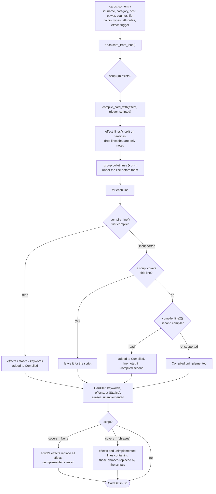
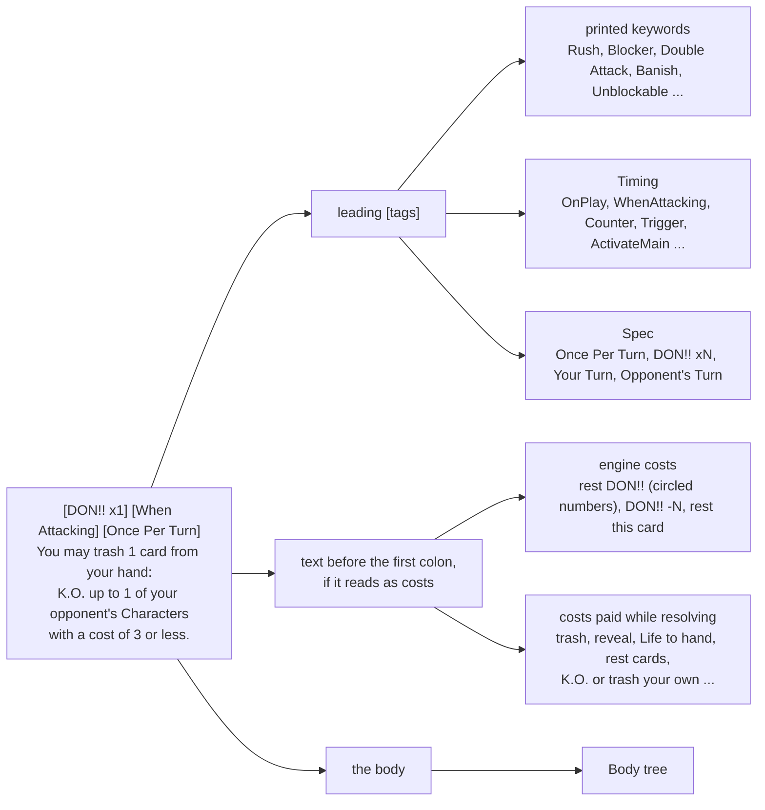
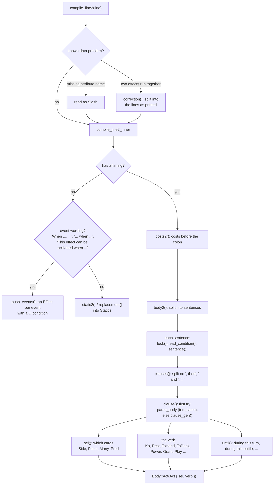

# Card compiler: from printed text to runnable effects

Every card in `data/cards.json` carries its printed text as plain strings (`effect` and
`trigger`). Nothing is hand-coded per card unless it has to be: when the Rust engine loads the
card database, it **compiles** each card's text into effect data once (`Db::load`, `db.rs`),
and games interpret that data. Today every one of the 2,850 cards is implemented
(`cargo run --release --example coverage` reports 0 lines missing).

There are three ways a line of text becomes an effect, tried in this order:

1. **The first compiler** (`compile.rs`): a port of `optcg/effect_text.py`. It reads exactly the
   lines the Python engine reads, the same way, so the two engines stay comparable. One regex
   template per common wording.
2. **The second compiler** (`compile2.rs`, building the general effects of `gen.rs`): Rust only.
   It reads a sentence as parts (which cards, what happens to them, for how long, under what
   condition), so one piece covers many wordings.
3. **Scripts** (`scripts.rs`, which mirrors `optcg/scripts.py`, and `scripts2.rs`, Rust only):
   hand-written functions for one-off cards.

A line is implemented only if every part of it is read. Anything else stays in
`CardDef::unimplemented` and the card plays without that line.

## The pipeline



The Python side runs the same pipeline with only the first compiler and Python scripts
(`optcg/carddb.py` `card_from_json`, `optcg/effect_text.py`, `optcg/scripts.py`), producing Python
closures instead of data.

## Step by step

### 1. Normalize

`normalize` (`compile.rs`; `normalize2` in `compile2.rs`) drops explanatory notes in parentheses
(rule 2-8-4, nested ones too), turns typographic dashes, quotes and full-width angle brackets
into ASCII, fixes a known misprint, and collapses whitespace.

### 2. Split into tags, costs and body



- `compile_line` strips `[tag]`s one by one. A printed keyword goes to `CardDef::keywords`. A tag
  that is a `Timing` (`Timing::from_tag`) makes the line an auto or activated effect. `[Once Per
  Turn]`, `[DON!! xN]`, `[Your Turn]` and `[Opponent's Turn]` fill a `Spec`. Any other tag, or two
  timings not written as alternatives (`[When Attacking]/[On Your Opponent's Attack]`), makes the
  line unsupported.
- **No timing** means a permanent effect: `compile_static` (or `static2`, `replacement`) reads it
  into `Statics` (power and cost changes, granted keywords, hand cost, "cannot be K.O.'d",
  replacement effects, Leader rules such as a 6-card DON!! deck).
- **A timing** means an `Effect`. The text before the first colon is parsed by `parse_costs`
  against `COST_PARTS`. Engine costs (rest DON!!, DON!! -N, rest this card) become `Effect`
  fields that `can_activate` and `pay_costs` check. Costs paid while resolving wrap the body in
  `Body::WithCosts` with a `Cond::Payable` condition, so the effect only activates when they can
  be paid.

### 3. Parse the body

`parse_body` (first compiler) tries, in order: a leading `If <condition>, ...` (`match_condition`,
clauses joined by "and"), "Your opponent may trash N cards... If they do not, ...", "You may
<cost>: ...", "You may ...", then each template in `templates()`. A template matches a prefix of
the sentence; the rest (after an optional "Then,") is parsed again and joined with `Body::Seq`.
"Choose one:" bullets become `Body::ChooseOne`.

When the first compiler fails, `compile_line2` re-reads the line with the second compiler:



The second compiler's vocabulary (`gen.rs`):

| Piece | Type | Examples |
|---|---|---|
| Which cards | `Sel::Cards { side, place, many, pred }`, `Sel::This`, `Sel::It`, `Sel::Rest` | "up to 1 of your opponent's rested Characters with a cost of 4 or less", "2 cards from your trash", "it" (the cards the previous action chose) |
| What a card must be | `Pred` | categories, names, types, colors, attributes, cost and power comparisons (against numbers counted in the game), rested, has a [Trigger], DON!! given, face-up |
| What happens | `Verb` | `Ko`, `Rest`, `SetActive`, `ToHand`, `ToDeck`, `Trash`, `ToLife`, `Power`, `Cost`, `BasePower`, `Grant`, `Negate`, `Play`, `GiveDon`, `Later` (end of turn), `AtBattleEnd`, `Redirect`, ... |
| Actions on no cards | `Do` | draw, return or rest DON!!, shuffle, reveal the top card, ... |
| Numbers | `Num` | a printed number, or Life, hand, trash, deck, DON!! counts, "for every 2 Events in your trash", the Leader's power, ... |
| Conditions | `Q` (wrapped as `Cond::Q`) | counts and comparisons ("you have 2 or more rested Characters"), whose turn, what is battling |

### 4. Store and run

The result is a `CardDef` with `effects: Vec<Effect>` (each a `Timing`, a `Body` tree, the
`Spec` fields, engine costs, an optional condition, and the original text for the log) and `st:
Statics`. During a game, `fire(timing, ...)` queues the card's effects of that timing, and
`Eng::run` walks the `Body` tree (see [Rust engine](engine.md#effects-and-when-they-happen)).

## A worked example: OP05-091 Rebecca

The card's text in `data/cards.json`:

```text
[Blocker]
[On Play] Add up to 1 black Character card with a cost of 3 to 7 other than [Rebecca] from your trash to your hand. Then, play up to 1 black Character card with a cost of 3 or less from your hand rested.
```

1. `effect_lines` gives two lines.
2. Line 1, `[Blocker]`: the tag is a printed keyword, so `Kw::Blocker` goes into
   `CardDef::keywords` and nothing else is left.
3. Line 2: the tag `[On Play]` is `Timing::OnPlay`. There is no colon, so no costs. The first
   compiler's `parse_body` has no template for "Add up to 1 ... from your trash to your hand"
   with a cost range and a name exclusion, so the line is `Unsupported` there.
4. No script covers OP05-091, so `compile_line2` reads it. `body2` splits two sentences at
   ". Then,". The first is read as a general action: `Sel::Cards` on my trash, up to 1, `Pred
   { Character, black, cost >= 3, cost <= 7, not named Rebecca }` with `Verb::ToHand`. The
   second, "Play up to 1 black Character card with a cost of 3 or less from your hand rested.",
   matches the first compiler's `PlayFrom` template (`Body::T`).
5. The card gets one `Effect { timing: OnPlay, body: Seq(Act(ToHand ...), T(PlayFrom ...)) }`.

`cargo run --release --example dump -- OP05-091` prints what the second compiler read:

```text
OP05-091  [On Play] Add up to 1 black Character card with a cost of 3 to 7 other than [Rebecca] from your trash to your hand. Then, play up to 1 black Character card with a cost of 3 or less from your hand rested.
    [On Play] ToHand UpTo(1) Me Trash {cats: [Character], not_names: ["Rebecca"], colors: ["black"], cost: [(Ge, K(3), false), (Le, K(7), false)], any_of: []}; TEMPLATE
```

In a game, when Rebecca is played, `play_character` calls `fire(OnPlay, [rebecca])`; the effect
queues, and `resolve` runs the body: a `Select` decision over the matching trash cards (with a
"Done" option, since it is "up to"), then a second `Select` over matching cards in hand, played
rested.

## Scripts

`scripts::script(id)` returns a `Script { covers, apply }` for the cards that need one (Rust
falls through to `scripts2::script2` for cards only the Rust engine implements).

- `covers: None`: the script's effects replace all of the card's compiled effects.
- `covers: Some(&["phrase", ...])`: the compilers skip lines containing those phrases (the
  `scripted` callback passed to `compile_card_with`), and the script's effects replace them.

Scripts are plain functions over `Eng` (`Body::Script`, `Cond::Script`, replacement and static
callbacks), used for Leader rules and one-off wordings.

## Debugging the compilers

| Command (in `engine-rs/`) | Shows |
|---|---|
| `cargo run --release --example coverage` | Cards and lines not implemented (`-- --list` prints each line and the part not read) |
| `cargo run --release --example dump -- OP05` | How the second compiler read each line of a set |
| `cargo run --release --example try -- "Draw 1 card."` | Which parts of a sentence the second compiler reads (`-- sel "..."` for a card selection, `-- line "..."` for a whole line) |

## Known differences from Python

On the cards both implement, the engines play the same games. The Rust engine implements text
Python doesn't (the second compiler and `scripts2.rs`). One Python bug is kept on purpose so the
engines stay comparable: the "Return up to N Characters with a [Trigger] to the owner's hand"
template reads its Trigger group as empty (`compile.rs`, `bounce`).
