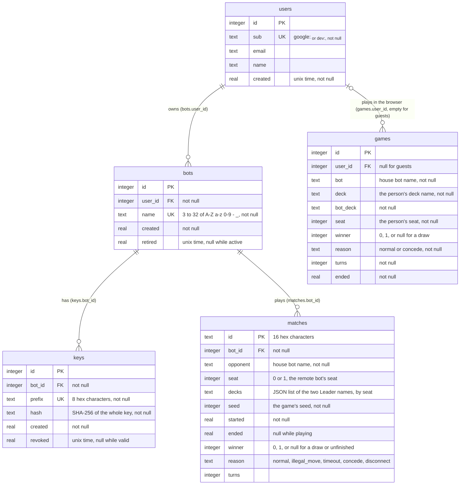
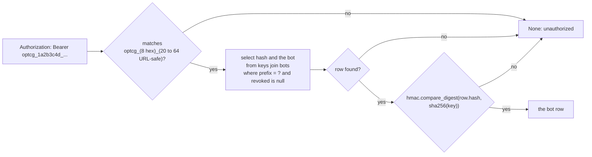
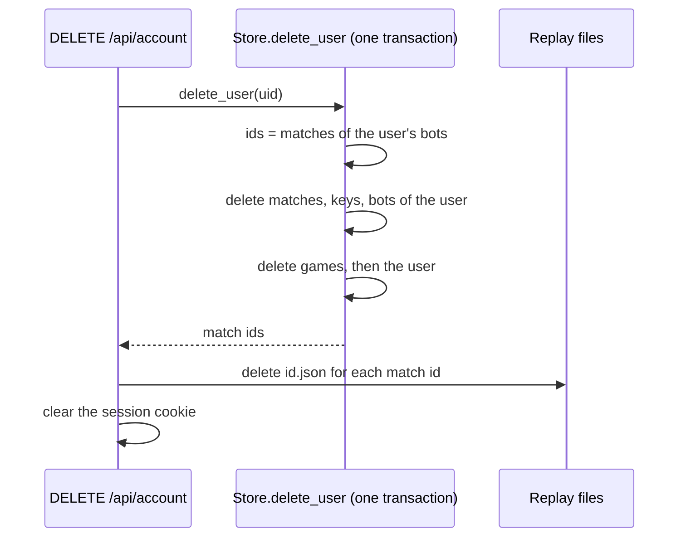

# Database

The server keeps its durable data in one SQLite file (`OPTCG_DB`, `/data/server.db` in Docker),
through `optcg/server/store.py`. The schema is created on startup (`create table if not
exists`), and one migration adds `bots.retired` to databases made before bots could be retired.

Live browser games are not in the database (they are in memory, see
[Web server](server.md#components-and-state)), and bot match replays are JSON files in
`OPTCG_REPLAYS`, named by match id.

## ER diagram

All times are Unix seconds (`time.time()`). Foreign keys are declared with `references` but
SQLite doesn't enforce them unless `pragma foreign_keys` is on, which the store doesn't set;
`delete_user` removes the rows in dependency order itself.

## Tables

### `users`

One row per person who has signed in. `sub` is Google's id for the person (prefixed `google:`),
which stays the same when their email changes; dev sign-in uses `dev:<name>`.
`Store.user(sub, email, name)` inserts, or on a known `sub` updates `email` and `name`.
`rename` sets `name` (1 to 40 characters).

### `bots`

A remote bot registered by a user. `name` is unique across all accounts. At most 10 active bots
per account (`MAX_BOTS`). Retiring (`delete_bot`) sets `retired`, revokes the bot's keys and
renames it to `name#id`, so the name can be taken again while its matches stay on record.
`Store.bots(user_id)` lists only active bots.

### `keys`

API keys for a bot. A key is `optcg_<prefix>_<random>`: `prefix` is 8 hex characters (stored,
unique, used to look the key up) and the random part is 32 URL-safe characters. Only the
SHA-256 of the whole key is kept, so a key is shown once, when it is made.

Revoking (`revoke`) sets `revoked`, only for a key whose bot belongs to the user asking.

### `matches`

One row per bot API match, written when the match starts (`start_match`) and completed when it
ends (`end_match`: `ended`, `winner`, `reason`, `turns`). `seat` is the remote bot's seat, so the
bot won when `winner = seat`. `decks` holds the Leader names, not the decklists; `seed` with the
replay file reproduces the game. A match whose server stopped mid-game keeps `ended` null.

### `games`

One row per finished browser game (`add_game`), written once when the game ends normally or by
concession. `seat` is the person's seat. Guests' games have no `user_id`; they still count in
the house bots' record.

## Queries the site runs

| Store method | Used by | What it reads |
|---|---|---|
| `record(bot_id)` | `GET /api/bots` | Finished matches and wins (`winner = seat`) for a bot |
| `matches(user_id, 20)` | `GET /api/bots` | The user's bots' last 20 matches, newest first |
| `games(user_id, 20)`, `game_totals` | `GET /api/account` | The user's last 20 browser games and totals |
| `house_record()` | `GET /api/analysis` | Per house bot: games and wins against people (`games`), and against remote bots (finished `matches`) |
| `match(id)` | tests only (`/matches/{id}` reads the replay file instead) | A match with its bot's name |

## Deleting an account

## Concurrency

The store uses one `sqlite3` connection shared across threads (`check_same_thread=False`) behind
a `threading.Lock`; every statement runs inside `with self.lock, self.db`, which also commits.
That is enough for one app process, which is how the site runs.

## Backups

`/data` (the `data` Docker volume) holds `server.db` and the replays. Copy it off the server from
time to time (see [`docs/hosting.md`](../hosting.md#backups)).
