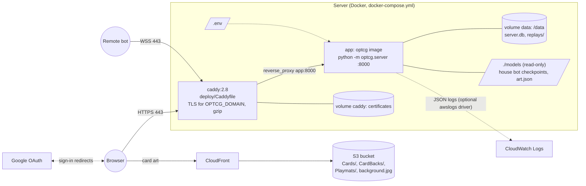
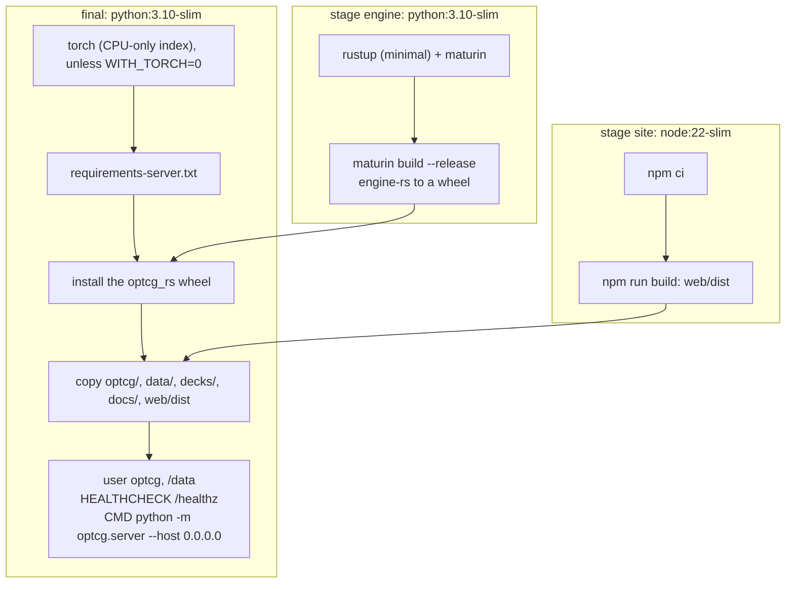
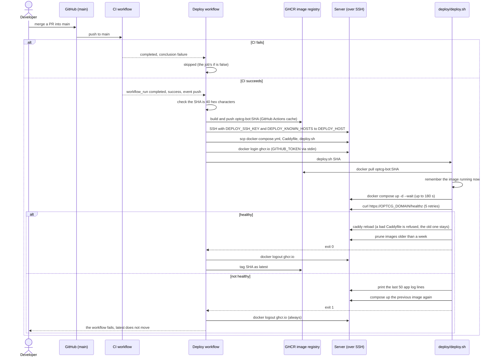

# Deployment

The site runs as one Docker container behind Caddy on a single small server, deployed
automatically when CI passes on `main`. Card art is served from S3 through CloudFront. The
step-by-step setup (server, domain, Google sign-in, art upload, house bots, logs, backups) is in
[`docs/hosting.md`](../hosting.md); this page shows how the pieces fit.

Configuration is by environment variable, in a `.env` file on the server (`.env.example` lists
every variable). This documentation names variables only, never their values.

## Production layout



- **Caddy** (`deploy/Caddyfile`) gets and renews the certificate for `OPTCG_DOMAIN`, compresses
  responses and proxies everything, WebSockets included, to `app:8000`.
- **The app container** runs as an unprivileged user, with `OPTCG_DB=/data/server.db`,
  `OPTCG_REPLAYS=/data/replays` and `PORT=8000` set in the image, and
  `OPTCG_SECURE_COOKIES=1` from the compose file. Its health check calls `/healthz`.
- **`./models`** is mounted read-only at `/app/models`: the house bots' checkpoints (named in
  `OPTCG_BOTS`) and the art manifest. Changing a bot takes `docker compose restart app`, not a
  deploy.
- **Card art** is not in the image. With `OPTCG_ART_BASE` set to the CloudFront URL and
  `OPTCG_ART_MANIFEST` pointing at the art list (made by `python -m optcg.server --art-manifest`),
  the table and the deck builder load images straight from CloudFront. Without them, the server
  serves art from a local `StreamingAssets/` folder at `/art/`, or the table draws text cards.
- **Logs** are one JSON object per line on stdout (`optcg/server/logs.py`); the commented
  `awslogs` block in `docker-compose.yml` sends them to CloudWatch.
- Live browser games are in the app's memory, so there is one app container, and a deploy ends
  the games in progress.

## The Docker image



`docs/` is copied in because the site serves `docs/bot-api.md` at `/api/docs/bot-api`.

## CI

`.github/workflows/ci.yml` runs on every pull request and every push to `main` (a newer push to
the same branch cancels the run in progress). Nothing is deployed from it.

| Job | What it does |
|---|---|
| Python tests | Python 3.10, CPU PyTorch, the server requirements, builds and installs the Rust engine wheel, `python -m unittest discover tests` |
| Rust tests | `cargo test --release` in `engine-rs/` (also builds the examples) |
| Site build | `npm ci` and `npm run build` in `web/` (typecheck and bundle) |
| Docker image | Builds the image without pushing it |

The Playwright browser tests are not in CI; they run locally (`npm run test:e2e` in `web/`).

## Automatic deploy

`.github/workflows/deploy.yml` runs when the CI workflow completes on `main`, or by hand with a
commit SHA (to roll back). It deploys only after CI succeeded on a **push** to this repository,
never for a pull request or a fork.



- Deploys run one at a time and are never cancelled halfway (`concurrency: deploy`).
- The job uses the GitHub environment `production`, which holds the secrets `DEPLOY_SSH_KEY` and
  `DEPLOY_KNOWN_HOSTS` and the variables `DEPLOY_HOST` and `SITE_URL`.
- **Rollback**: Actions, Deploy, Run workflow with an older commit's full SHA. A manual run
  skips the build and deploys the image already in the registry for that SHA.
- The site is down for as long as the new container takes to start, and live games end, so
  merging to `main` is what restarts the site.

## Running it locally

```bash
.venv/bin/pip install -r requirements-server.txt
(cd web && npm install && npm run build)
OPTCG_DEV_LOGIN=1 .venv/bin/python -m optcg.server     # http://127.0.0.1:8000
```

The Rust engine must be built into the virtualenv first (see
[`engine-rs/README.md`](../../engine-rs/README.md)). `docker compose up -d --build` runs the
production layout locally, with a `.env` made from `.env.example`.
