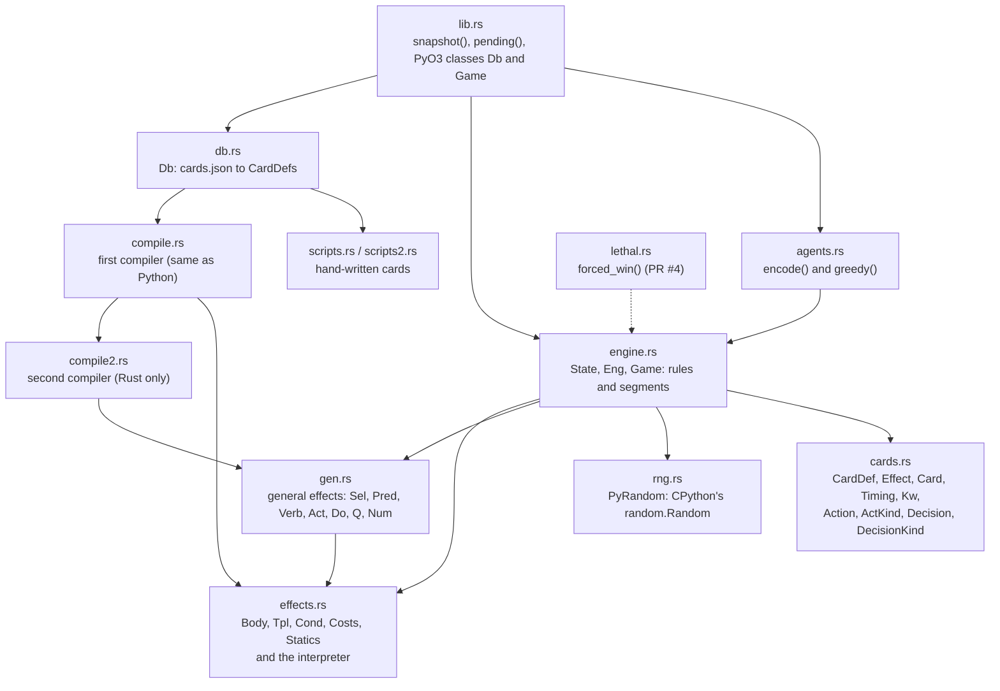
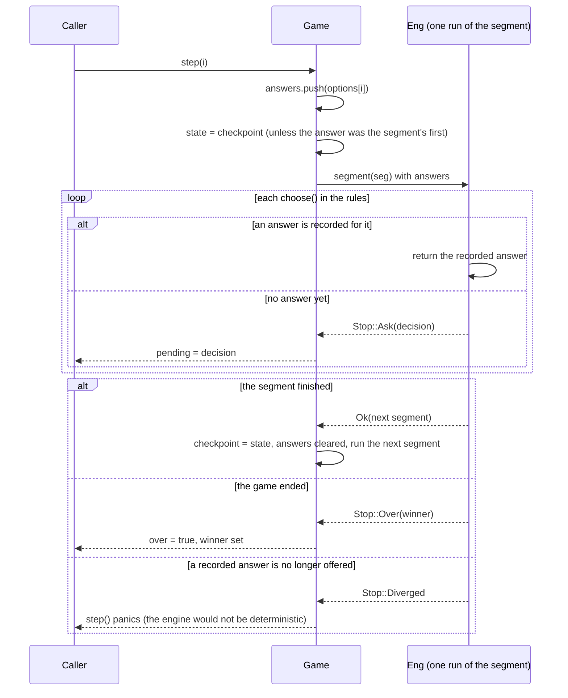
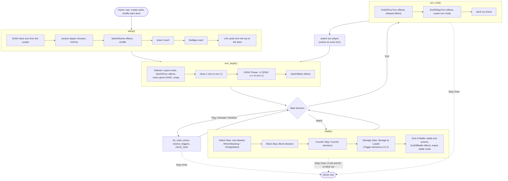
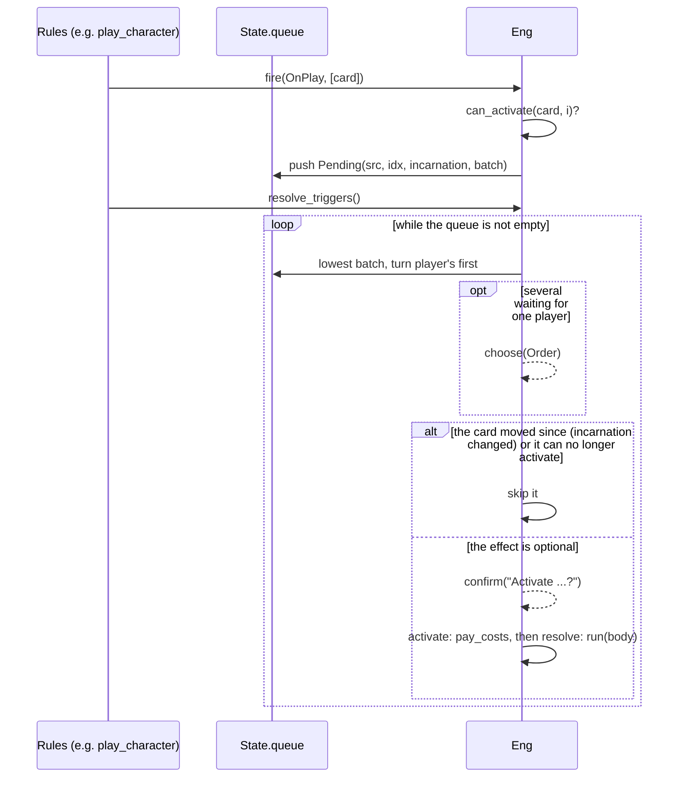
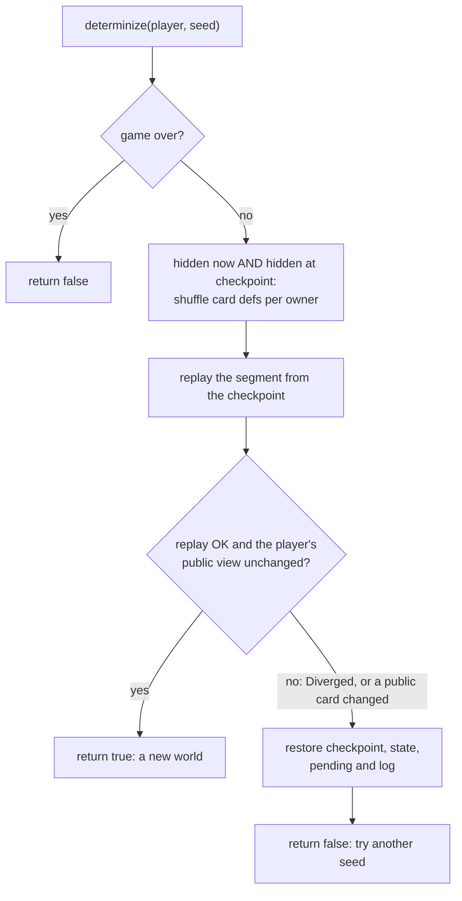
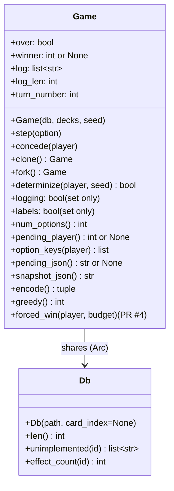
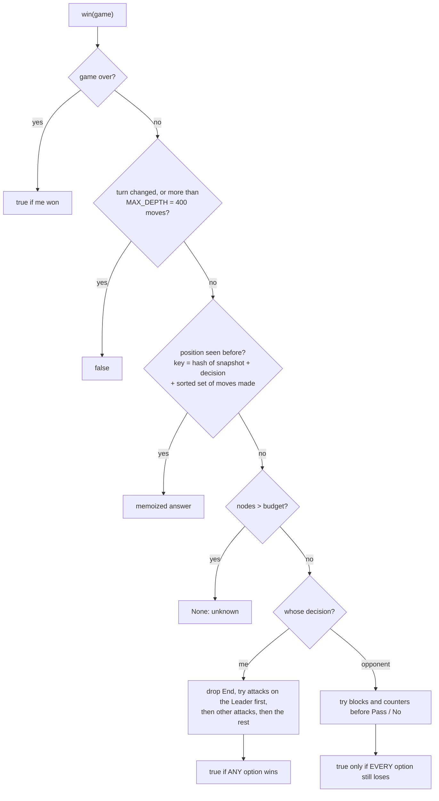

# Rust engine (`engine-rs/`)

The rules engine, built as the Python module `optcg_rs` (and as a plain Rust library for
`cargo test` and the examples). It began as a port of the Python engine in `optcg/engine.py`
and still matches it decision by decision on the cards both implement: the same seed and the
same answers give the same state, options, prompts and log. `tests/test_rust_engine.py` and
`tests/rust_parity.py` check that.

Building, the examples and the speed table are in [`engine-rs/README.md`](../../engine-rs/README.md).

## Modules

| Module | Lines | Role |
|---|---|---|
| `cards.rs` | ~540 | Printed data (`CardDef`, `Effect`), a physical card in a game (`Card`), and the vocabularies: `Category`, `Timing`, `Kw`, `Zone`, `Until`, `ModKind`, `ActKind`, `Action`, `DecisionKind`, `Decision` |
| `db.rs` | ~130 | `Db::load("data/cards.json")`: compiles every card once; `by_id` maps a card id to its index |
| `engine.rs` | ~2,400 | `State` (everything that changes), `Eng` (the engine while it runs a segment) and `Game` (a game in progress) |
| `effects.rs` | ~1,200 | Effects as data (`Body`, `Tpl`, `Cond`, `Costs`, `Statics`) and `Eng::run`, the interpreter |
| `gen.rs` | ~1,800 | General effects built by the second compiler, and their interpreter |
| `compile.rs`, `compile2.rs` | ~1,050, ~3,200 | Card text to effects: see [Card compiler](compiler.md) |
| `scripts.rs`, `scripts2.rs` | ~480, ~190 | Hand-written effects for cards neither compiler reads |
| `rng.rs` | ~170 | CPython's Mersenne Twister, `shuffle`, `randrange` and `sample`, bit for bit |
| `agents.rs` | ~320 | The network's observation (`encode`) and the greedy bot (`greedy`) |
| `lib.rs` | ~250 | `snapshot` and `pending` as JSON, and the PyO3 bindings |
| `lethal.rs` | ~100 | Exhaustive search for a forced win this turn. In [PR #4](https://github.com/LordHoboDojo/optcg-bot/pull/4) (branch `lethal-checker`), not yet on `main` |

## State

- **`Card`** (`cards.rs`): `uid`, `def` (index into `Db::defs`), `owner`, `zone`, `face_up`,
  `rested`, `don` (DON!! given to it), `played_turn`, `mods` (power, cost, keywords, negation and
  so on, each with an `Until`), `opt_used` ([Once Per Turn] bookkeeping), `revealed`, and
  `incarnation`, which goes up every time the card changes zone (rule 3-1-6). Effects and
  battles remember a card's incarnation, so "that card" stops meaning it once it has moved.
- **`PlayerState`** (`engine.rs`): the Leader, Characters (at most `MAX_CHARACTERS` = 5), Stage,
  hand, deck, trash, Life, the DON!! deck and active and rested DON!!, plus per-turn flags.
- **`State`**: the RNG, both players, every card, turn number, turn player, phase, the current
  `Battle`, the queue of auto effects waiting to resolve (`queue`), effects delayed to the end
  of the turn (`delayed`), and context the card text can refer to ("the last K.O.", "the last
  Character played", and so on).
- **`Game`**: the `State` at the pending decision, the `checkpoint` state the current segment
  started from, the answers given in this segment, the log, the `pending` decision, and
  `over` / `winner`. Everything is plain data, so `clone()` copies a game.

## Decisions and options

A **decision** (`Decision`) is a player, a kind, a prompt and a list of options. An **option**
(`Action`) is an `ActKind` with an optional acting card, target card and effect index, plus a
label. Callers answer with the option's number.

| `DecisionKind` | When it is asked | Typical options (`ActKind`) |
|---|---|---|
| `GoFirst` | Setup: the randomly chosen player picks | `First`, `Second` |
| `Mulligan` | Setup, each player once | `Keep`, `Mulligan` |
| `Main` | Every Main Phase action | `Play`, `Activate`, `GiveDon`, `Attack`, `End` |
| `Block` | Block Step, when the defender has an active [Blocker] | `Pass`, `Block` |
| `Counter` | Counter Step, repeated until `Pass` | `Pass`, `Counter` (card + target), `Event` |
| `Trigger` | A Life card with [Trigger] is taken as damage | `Yes`, `No` |
| `Select` | An effect picks cards one at a time | `Select`, and `Pass` ("Done") unless exactly N |
| `Confirm` | "You may ...", optional effects, paying optional costs | `Yes`, `No` |
| `ChooseOne` | "Choose one:" effects | `Select` with an index |
| `Cost` | Choosing how to pay a cost | `Select` |
| `Order` | Several auto effects of the same batch are waiting | `Select` (card + effect index) |
| `OrderCards` | Placing cards in an order (bottom of the deck) | `Select` |
| `ReturnDon` | Returning DON!! to the DON!! deck | `Select` |

A decision with exactly one option is never asked: `Eng::choose` takes it at once.

## The game loop: segments and replay

The Python engine pauses a generator at each decision. Paused generators can't be copied, which
search needs, so the Rust engine runs in **segments** instead (`engine.rs`, `Game::advance`):

- A segment starts from a saved state (`checkpoint`): the start of the game, or a Main Phase
  decision.
- Running a segment calls `Eng::segment`. Every time the rules need an answer they call
  `Eng::choose`, which either returns the next answer recorded for this segment or stops the
  segment with `Stop::Ask(decision)`.
- `Game::step(i)` records answer `i` and **re-runs the segment from its checkpoint** with one
  more answer. Segments are one Main Phase action long, so this is cheap (a few microseconds).
- When a segment finishes (`Ok(Seg::Main)`), its end state becomes the new checkpoint and the
  answers are cleared.

Errors from `step`: an option number that isn't offered returns `Err("no option N for kind")`
and a finished game returns `Err("the game is over")`; the Python binding turns both into
`ValueError`. `Stop::Diverged` only happens on purpose inside `determinize` (below).

### Turn structure

`Eng::segment(Seg::Start)` runs setup and the first turn's start; every later segment is one
Main Phase decision and what follows it.

How a game ends (`Stop::Over`):

- **Damage with 0 Life** (`deal_damage`): the attacker's player wins.
- **Deck out** (`check_rules` / `deck_out`, rule 9-2): a player with an empty deck loses, checked
  before every decision. Leaders can change this ("you win instead", or "lose at the end of the
  turn"). Both decks empty is a draw.
- **Concede** (`Game::concede`, rule 1-2-3): the other player wins at once. A battle in progress
  is ended first.
- In Python, `optcg.play` and `optcg.web` give up after `MAX_STEPS` = 20,000 decisions with a
  `RuntimeError`.

### Effects and when they happen

Effects with a timing (`Timing::OnPlay`, `WhenAttacking`, `OnKo`, `Trigger`, ...) are **auto
effects**. When something happens, the engine calls `fire(timing, cards)`, which queues a
`Pending` entry for every effect on those cards that `can_activate` (not negated, right turn,
enough DON!! given, [Once Per Turn] unused, condition true, costs payable). `resolve_triggers`
then resolves the queue (rule 8-6): the oldest batch first, the turn player's effects first,
and an `Order` decision when one player has several waiting.

`Eng::run` (`effects.rs`) interprets a `Body`:

| `Body` | Meaning |
|---|---|
| `Seq(a, b)` | Do `a`, then `b` ("Then, ...") |
| `If(cond, body)` | Do it only if the condition holds now |
| `Optional(body)` | "You may ...": a `Confirm` decision |
| `WithCosts { costs, ask, body }` / `Pay { costs, ask, body }` | Pay costs while resolving (trash a card, rest a Character, ...), asking first if `ask` |
| `IfDid(a, b)` | "You may A. If you do, B." |
| `ChooseOne { opponent, options }` | "Choose one:" bullets |
| `UnlessOppTrashes(n, body)`, `OppMay`, `OppMayElse` | The opponent decides |
| `T(Tpl)` | One of the first compiler's templates (K.O., Rest, Draw, Look, PlayFrom, ...) |
| `Act(Act)` / `Do(Do)` | A general action from the second compiler: a selection of cards and a verb, or an action on no cards |
| `Script(fn)` | A hand-written function |

Permanent effects (power and cost changes, granted keywords, "cannot be K.O.'d", Leader rules)
are not queued. They live in `CardDef::st` (`Statics`) and are read every time the engine asks
`power(u)`, `cost(u)`, `has_keyword(u, kw)` and so on. Replacement effects ("If this Character
would be K.O.'d, ... instead") are checked in `replaced` and `damage_replaced`.

## Hidden information: `fork` and `determinize`

- `Game::fork()` copies a game without its log and with log lines, labels and prompts switched
  off from then on. This is what search copies (about 2 microseconds).
- `Game::determinize(player, seed)` reshuffles what `player` can't see: the opponent's hand
  (except revealed cards), both decks and face-down Life, each owner's cards among themselves.
  The shuffle is applied at the segment's checkpoint and the segment is replayed, so the new
  world is consistent with every answer already given.

`Game::option_keys(player)` names each option in a way that means the same thing in every
world: a card the player can see by its uid, a hidden one as `1,000,000 + card number`. The
MCTS tree is keyed by these (see [Python package](python.md#search-mcts-with-determinization)).

## Python bindings (`lib.rs`)

Built with the `python` feature (PyO3 0.25, abi3 for Python 3.10+) by maturin. `engine-rs/pyproject.toml`
sets the module name.

- `decks` is `[(leader id, [50 card ids in order]), ...]` for players 0 and 1, in the order the
  Python `Deck` holds them, so both engines create and shuffle the same cards.
- Errors become `ValueError`: an unknown card id, not two decks, an option that isn't offered,
  stepping or conceding a finished game, `encode()` or `greedy()` with no pending decision.
- `pending_json()` is `{"player", "kind", "prompt", "options": [[kind, card, target, index, label], ...]}`.
- `snapshot_json()` is the whole state (both hands and decks included) as JSON; `optcg.replay`
  builds the table's frames from it and hides what a seat may not see.

## Agents in Rust (`agents.rs`)

Both match the Python versions exactly, so training data doesn't depend on the engine.

- **`encode(e, decision)`** builds the network's observation for the player who must decide:
  `scalars` (Life, hand, DON!!, turn, phase and so on); one row of 16 numbers per card that
  player can see (`CARD_FIELDS`: card index, mine or not, zone, category, power, cost, counter,
  rested, DON!! given, played this turn, in the current battle, and five keywords); one row of
  6 numbers per option (`OPTION_FIELDS`); and the decision kind's index. The opponent's hand
  appears only as revealed cards, and face-down Life not at all. The card index comes from
  `Db::set_card_index` (`optcg.env.card_index()`), so card ids line up with the network's
  embedding table.
- **`greedy(e, decision)`** is the rule-of-thumb baseline (`GreedyAgent`). It goes first, keeps
  its hand, uses every Trigger and says yes to every confirm. In the Main Phase it plays its
  most expensive Character, then an Event, a Stage, an Activate effect, gives DON!! to its
  Leader, and attacks where its power is at least the target's (the Leader first), else still
  swings at the Leader. It blocks with a card stronger than the attacker, or its cheapest
  blocker when its Leader is hit on 2 or less Life, and counters only when the target is a
  Character costing 4 or more or the Leader on 3 or less Life and the hand can cover the gap.
  For other effect choices it harms the opponent's strongest card or helps its own.

## Lethal search (`lethal.rs`)

> In [PR #4](https://github.com/LordHoboDojo/optcg-bot/pull/4) (branch `lethal-checker`), not
> yet merged. It adds `engine-rs/src/lethal.rs`, `Game.forced_win` in `lib.rs` and
> `tools/lethal.py` (see [Tools](tools.md#lethal-checker-pr-4)).

`forced_win(game, me, budget)` asks whether `me` wins **before the current turn ends whatever
the opponent does**. It is an AND/OR search over the real game (it sees the opponent's hand and
the deck order): at `me`'s decisions some option must win, at the opponent's decisions (blocks,
counters, Triggers) every option must fail to stop it.

It returns `(Some(true|false) or None, positions searched)`. Positions reached by different
orders of the same moves (DON!! to A then B, or B then A) are searched once.

## Tests

- `engine-rs/tests/smoke.rs` and `tests/general.rs`: Rust tests, the second on boards set up with
  `Game::arrange`.
- `tests/test_rust_engine.py` and `tests/rust_parity.py`: the two engines compared decision by
  decision on the same seeds.
- `cargo run --release --example fuzz`: random games with random decks of implemented cards.
- `cargo run --release --example coverage`: card text not implemented (today none: 2,850 cards,
  0 lines missing).
