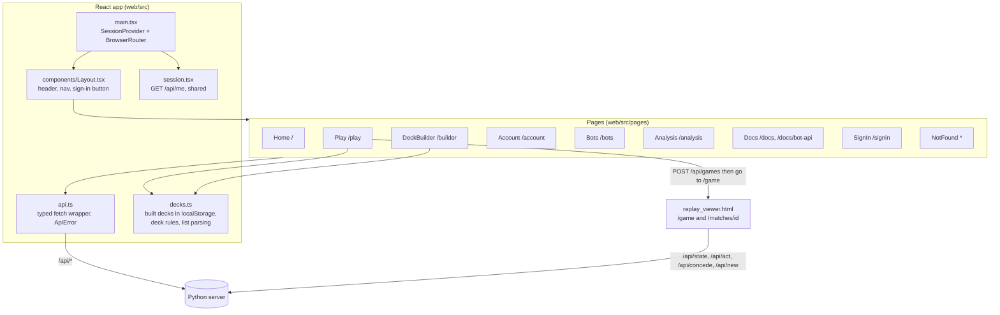
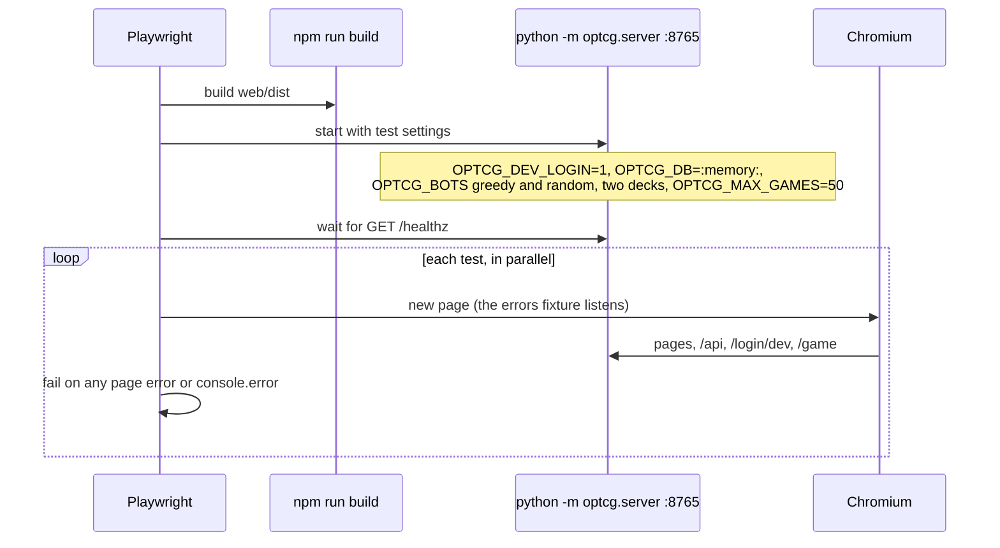

# Frontend (`web/`)

The site people see is a React 19 app (React Router 7, TypeScript, Vite), built into
`web/dist`, which the Python server serves. It talks only to the server's JSON API
(`web/src/api.ts`). The **game table** is not part of the React app: it is
`optcg/replay_viewer.html`, the same page that plays back replays, served by the server at
`/game` (live) and `/matches/<id>` (a bot match replay).



## Pages

| Route | Page | Reads | Writes |
|---|---|---|---|
| `/` | `Home` | `GET /api/options` | |
| `/play` | `Play`: pick your deck (site decks and your built decks), the opponent's deck and a house bot; filter by name, color and full coverage | `GET /api/options`, `localStorage` | `POST /api/games`, then opens `/game` |
| `/builder` | `DeckBuilder`: build a deck card by card, paste a list, or copy a site deck; curve and type counts; problems listed as you go | `GET /api/cards`, `GET /api/options`, `GET /api/deck` | `localStorage` (`optcg.decks`) |
| `/account` | `Account`: name, game totals and history; rename, sign out, delete the account | `GET /api/account` | `PATCH`, `DELETE /api/account`, `POST /api/logout` |
| `/bots` | `Bots`: register bots, make and revoke API keys, retire bots, recent matches, the WebSocket URL | `GET /api/bots` | `POST /api/bots`, `POST /api/bots/{id}/keys`, `DELETE /api/keys/{id}`, `DELETE /api/bots/{id}` |
| `/analysis` | `Analysis`: bot ratings, head-to-head results, training curves, house bots' records (`components/charts.tsx`) | `GET /api/analysis` | |
| `/docs`, `/docs/bot-api` | `Docs`: `docs/bot-api.md` rendered with `marked` | `GET /api/docs/bot-api` | |
| `/signin` | `SignIn`: the Google button, a name form for dev sign-in (`/login/dev`), or "sign-in isn't set up"; `?failed=1` shows an error | session | |
| anything else | `NotFound` | | |

`components/Haki.tsx` draws the decorative "Conqueror's Haki" art from a seeded generator, so
it is the same on every load.

The server serves `web/dist/index.html` only for the routes in `app.py`'s `PAGES` tuple; any
other path gets the same `index.html` with status 404, which React shows as `NotFound`. If
`web/dist` hasn't been built, the server answers 503 with "The site isn't built".

### Errors in the pages

`api.ts`'s `call()` throws `ApiError(status, code, detail)` for any non-2xx answer. Pages show
`detail` in a notice: for example `bad_deck` and `busy` on the Play page, `signed_out` turning
Account and Bots into a sign-in prompt, and parse errors in the deck builder's pasted list.

### Built decks

`decks.ts` keeps decks in `localStorage` under `optcg.decks`, never on the server. Every
read and write is wrapped in `try`, so a private window or blocked storage gives an empty list
and a warning instead of a broken page. `problems()` mirrors `optcg/deck.py` (a Leader, 50
cards, shared colors, at most 4 copies unless unlimited); `wire()` turns a built deck into the
`1xLEADER` / `Nx<id>` list the server reads with `parse_decklist`, and the server validates it
again. See the [deck building sequence](server.md#deck-building).

## The game table (`optcg/replay_viewer.html`)

One self-contained HTML page with inline JavaScript. The server fills in the game's data (the
players, every card's definition and art paths) and, for a live game, a `live` block with the
person's seat.

- **Replay mode** (a file from `optcg.replay`, or `/matches/<id>`): all frames are in the page.
- **Live mode** (`/game`): on load it fetches `GET /api/state?from=0`. Each click on an option
  posts `POST /api/act {frame, option}`; the answer carries the frames the bot played since,
  which the page plays one by one, then shows the next decision. Concede and New game post to
  `/api/concede` and `/api/new`.
- A timeline on the right steps back through every frame, also during a live game.

## Development

```bash
cd web
npm install
npm run dev     # http://127.0.0.1:5173, proxies the API to the Python server on :8000
npm run build   # tsc -b (typecheck) and vite build into web/dist
```

`vite.config.ts` proxies `/api` (with WebSockets), `/game`, `/matches`, `/art`, `/login`,
`/logout`, `/auth`, `/decks` and `/healthz` to `http://127.0.0.1:8000`.

## Browser tests (Playwright)

`web/e2e/` holds end-to-end tests run in Chromium against the real server; how to run them is in
[`web/e2e/README.md`](../../web/e2e/README.md).



| File | Tests |
|---|---|
| `fixtures.ts` | `test` with an automatic `errors` fixture: any uncaught exception or `console.error` fails the test (failed resource loads are allowed, since unknown addresses are meant to 404). Helpers: `signIn` (`/login/dev`), `startGame` (`POST /api/games` then `/game`), `answerDialogs` |
| `site.spec.ts` | The home page links; moving between pages never leaves a blank page; the not-found page; the bot API docs render; the Play page lists, filters and starts a game; `/game` without a game goes back to Play; signed out, Your bots and Account ask you to sign in, and the dev sign-in button signs you in; signed in, rename, register a bot, make and revoke a key, retire the bot, sign out |
| `builder.spec.ts` | Build a deck card by card and keep it in the browser; a pasted list and its problems; copy a site deck and play it against a bot; an unfinished deck can't start a game |
| `table.spec.ts` | A whole game against greedy through the page, always ending the turn and taking the first option, until the table shows Defeat and `/api/state` agrees; conceding ends the game; New game starts a fresh game; the timeline steps back and returns; a recorded replay file plays from start to finish |

CI builds the site (`npm run build`, which typechecks) on every pull request; the Playwright
tests are run locally (see [Deployment](deployment.md#ci)).
