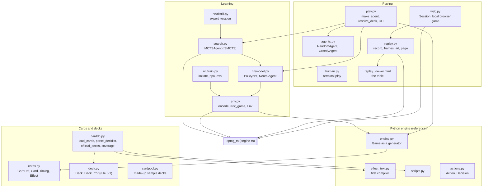
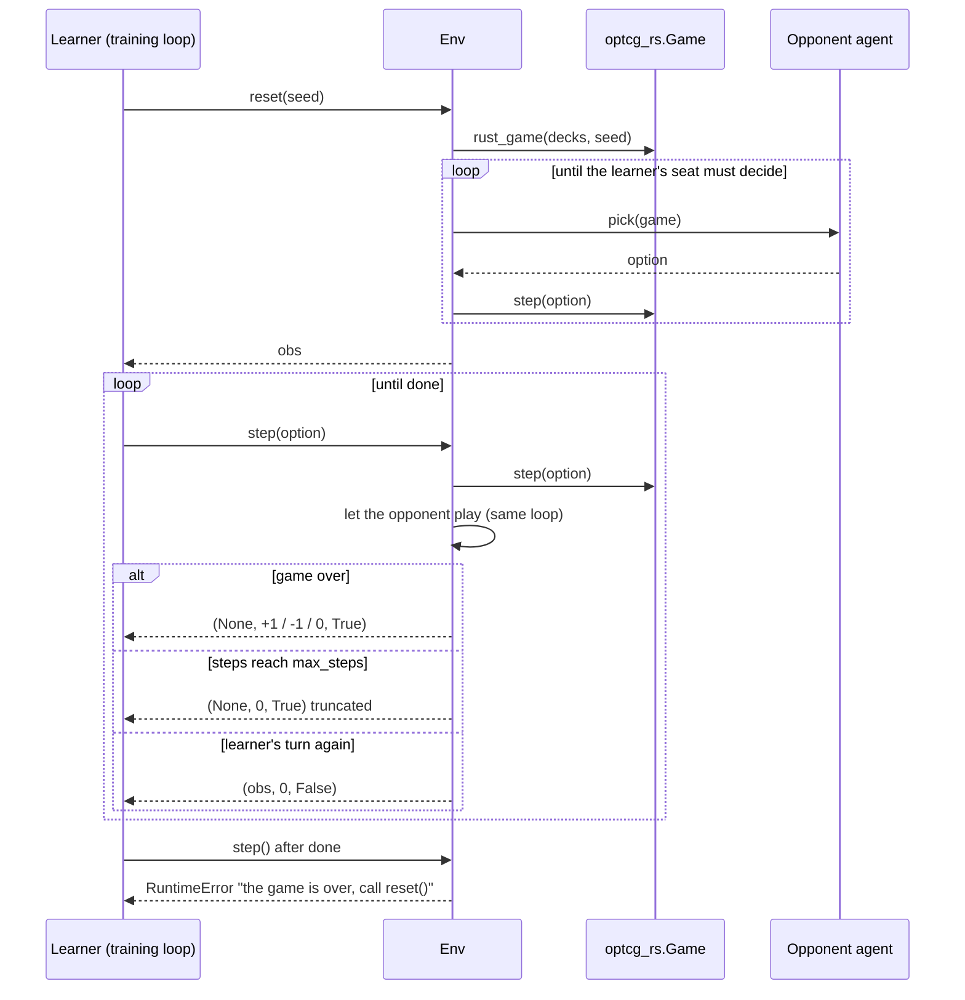
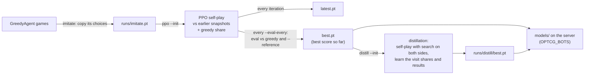
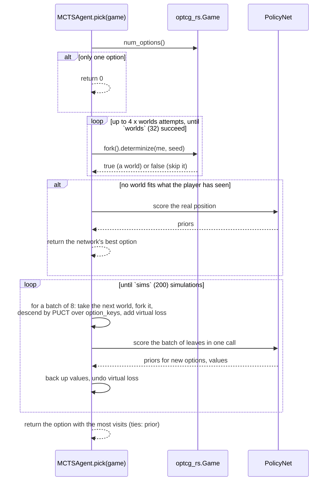

# Python package (`optcg/`)

The Python side holds the card data and deck rules, the original Python rules engine, the
training environment, every bot, the training code, the replay recorder and the local browser
game. Anything that plays a real game runs it on the Rust engine (`optcg_rs`) when it is built;
the Python engine remains the reference the Rust one is checked against, and `optcg.play`'s
bot-vs-bot and terminal games still use it.

## Cards and decks

- `carddb.load_cards()` reads `data/cards.json` into Python `CardDef`s (compiling text with
  `effect_text.py` and `scripts.py`), cached.
- `carddb.parse_decklist(text)` reads `4xOP01-016` or `4 OP01-016 Name` per line, Leader
  included. `carddb.official_decks()` builds the recommended decks from `data/decks.json`.
- `deck.Deck.validate()` checks the deck rules (rule 5-1): a Leader, 50 cards, at most 4 copies
  (unless the card says any number is allowed), colors shared with the Leader. It raises
  `DeckError` with every problem.
- `play.resolve_deck(spec)` turns a name into a `Deck`: `sample-red` / `sample-green`, a file
  path, `decks/<name>.txt`, or an official deck by (part of) its name.
- `carddb.coverage(deck, unimplemented)` counts the deck's effect lines the engine carries out.
  `play.coverage` passes the Rust engine's `Db.unimplemented` when it is built.

## The training environment (`env.py`)

- `card_index()` numbers every card id for the network's embedding table.
- `encode(game, decision)` (Python engine) and `encode_rust(game)` (`Game.encode()` in Rust)
  give the same observation: `scalars`, `cards` (one row per visible card), `options` (one row
  per legal option), `decision`, `player`. A policy scores each option row, since the number
  and meaning of options change at every decision.
- `rust_game(decks, seed, fast=True)` makes an `optcg_rs.Game` from Python `Deck`s, with log
  lines and labels off when `fast`.
- `Env(deck0, deck1, opponent, seat, max_steps, engine)`: the learner plays `seat`, the
  `opponent` agent answers the other seat inside `step()`. Reward is +1 for a win, -1 for a loss,
  0 for a draw or a game cut off at `max_steps`. With `opponent=None` the caller answers both
  seats (used to batch many games' network calls).

## Bots

`play.make_agent(spec)` builds a bot from a spec string; the server's house bots use the same
specs (`OPTCG_BOTS`).

| Spec | Class | How it picks |
|---|---|---|
| `random` | `agents.RandomAgent` | A uniformly random option |
| `greedy` | `agents.GreedyAgent` | Rule-of-thumb play; on Rust it calls `Game.greedy()` |
| `path/to/model.pt` | `nn.model.NeuralAgent` | The network's best-scored option |
| `mcts:path/to/model.pt` | `search.MCTSAgent` | Search guided by the network (Rust only) |
| anything else | | `SystemExit("unknown bot ...")` |

Every agent has `act(game, decision)` for the Python engine and `pick(game)` (an option number)
for the Rust engine.

### The policy network (`nn/model.py`)

`PolicyNet` embeds each visible card by id plus its numbers, mixes them with one Transformer
encoder layer so each card sees the board, pools them into "mine" and "theirs", and adds the
scalars and the decision kind to make a state vector. Each option is encoded from its action
kind, effect index, acting card and target (taken from the mixed card rows) and scored against
the state. A value head predicts the final reward. `save` / `load` keep the weights with the
hidden size and training metadata.

## Playing games

- `python -m optcg.play`: bot-vs-bot win rates, `--human N` to play in the terminal
  (`human.py`), `--list-decks` and `--missing DECK` for coverage. Bot-vs-bot and terminal games
  run on the Python engine.
- `python -m optcg.replay`: records a game on the Rust engine and writes it as one HTML file
  (`replay_viewer.html` with the frames inlined). One frame per decision, both hands visible.
- `python -m optcg.web`: a local browser game against a bot on a small `ThreadingHTTPServer`,
  the same table as the replays. The hosted site reuses its `Session` class.

### `web.Session`: one game, one hidden seat

`Session(decks, bot_spec, human_seat, seed, name)` is the heart of every browser game and every
bot API match. It runs an `optcg_rs.Game`, lets the bot play until the person's seat must decide,
and keeps a list of **frames** (the board and the decision at each step) built from
`snapshot_json` and `pending_json`.

- The opponent's hand is face down in every frame (`H` rows are `{}` unless revealed).
- Of the bot's decisions, only the option it picked is shown, never the other options (they
  would give its hand away), and none at all for `order` and `order_cards` decisions
  (`SECRET_KINDS`), whose answer would show where hidden cards went.
- `act(frame, option)` raises `ValueError("that decision has already been made")` if `frame` is
  not the latest or the game is over, and `ValueError("no such option")` for a bad number.
- `concede()` ends the game for the person's seat and adds a final frame.
- `_advance` raises `RuntimeError` if a game runs past `MAX_STEPS` decisions.

## Training (`nn/train.py`, `nn/distill.py`)

- **`imitate`**: supervised learning of `GreedyAgent`'s choices, a fast and sane start.
- **`ppo`**: actor-critic self-play. Each iteration, worker processes play `--games` games
  against earlier snapshots of the network (and `GreedyAgent` for `--greedy-share` of them), on
  the Rust engine when it is built. The learner computes advantages (GAE), then runs PPO epochs
  (clipped ratio, value loss, entropy bonus). `latest.pt` is saved every iteration; every
  `--eval-every` iterations it is evaluated against greedy and, with `--reference`, against a
  fixed checkpoint, and `best.pt` keeps the best.
- **`eval`**: win rate of a checkpoint against an agent or another checkpoint, both seats.
- **`--league`**: instead of one matchup (Rocks vs Linlin by default), every pairing of the
  official decks the engine fully implements, sampled per game.
- **`nn/distill.py`** (expert iteration): games of the network against itself with search on
  both sides; every searched decision keeps the share of visits each option got and, at the
  end, the result. The network learns to match the visit shares (cross-entropy) and to predict
  the result (value head). Needs the Rust engine.

## Search: MCTS with determinization

`search.MCTSAgent` (spec `mcts:<checkpoint>`) is information-set Monte Carlo tree search guided by
the network, AlphaZero style: the network's option scores are the priors (PUCT), and its value
head scores the position where a simulation stops, so there are no random playouts.

- **Worlds.** Each world is a fork of the real game with the hidden cards reshuffled
  (`Game.determinize`, see [Rust engine](engine.md#hidden-information-fork-and-determinize)).
  A reshuffle that wouldn't fit what the player has seen is refused, and another seed is tried.
- **One shared tree.** All worlds share one tree, keyed by `Game.option_keys(me)`, which names
  an option the same way in every world. So the opponent's moves with cards it might hold are
  searched too (single-observer ISMCTS).
- **Batching.** One network call costs about 0.6 ms and a batch of 8 about 1.5 ms, so leaves are
  scored in batches, with virtual loss keeping a batch's simulations on different paths.
- **Noise.** `noise` mixes Dirichlet noise into the root's priors, for training games.
- `python -m optcg.search CHECKPOINT --vs net|greedy --games N` compares the search with the
  plain network or greedy.

## Tests

`tests/` runs with `python -m unittest discover tests`: rules (`test_rules.py`,
`test_rule_details.py`, set-specific tests), card data, the environment, agents, the network
and training (need PyTorch), search, replays, the local web game, the Rust engine and its parity
with the Python engine, and the server (`test_server.py`).
