# Web server (`optcg/server/`)

A FastAPI app that serves the React site and its JSON API, the game table, Google sign-in,
accounts, bots and API keys, and the WebSocket bot API. It runs under uvicorn
(`python -m optcg.server`), behind Caddy in production (see [Deployment](deployment.md)).

| File | Role |
|---|---|
| `__main__.py` | Command line: `--host`, `--port` (or `HOST`, `PORT`), `--art-manifest FILE` (write the art file list and exit). Sets up JSON logs and runs uvicorn with proxy headers trusted |
| `config.py` | `Config.from_env()`: every setting from environment variables; the house bots and the deck list |
| `app.py` | `create_app(cfg)`: middleware, the JSON API, browser games (`Rooms`), sign-in, account, bots and keys, replays, the React app's routes |
| `botapi.py` | `BotMatches`: the WebSocket bot API, one match per connection |
| `store.py` | `Store`: SQLite (see [Database](database.md)) |
| `logs.py` | One JSON object per log line on stdout (`event(name, **fields)`), for CloudWatch |

It builds on `optcg/web.py` (`Session`, one game with one hidden seat, see
[Python package](python.md#websession-one-game-one-hidden-seat)) and `optcg/replay.py` (the table
page and card art).

## Components and state

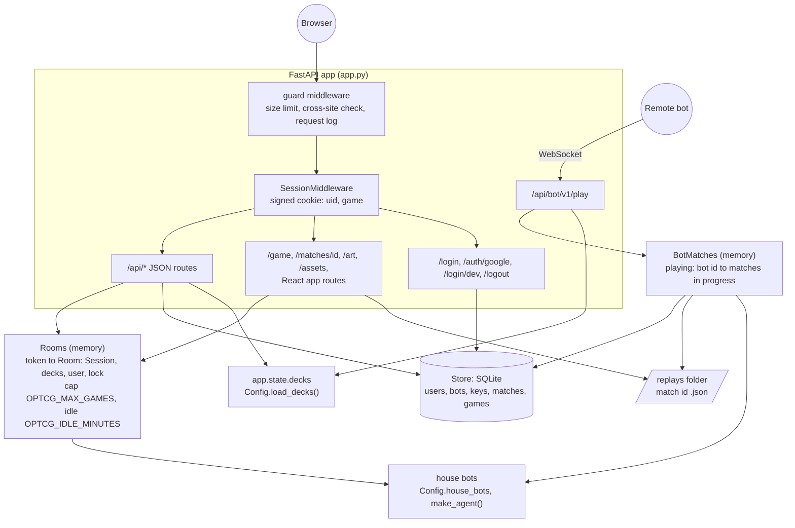

- **Live browser games** are `Room`s in memory, keyed by a random token stored in the visitor's
  session cookie (`game`). A restart or deploy ends them all. A room left idle for
  `OPTCG_IDLE_MINUTES` is dropped the next time a game is created, and at most
  `OPTCG_MAX_GAMES` exist at once. Run one copy of the app.
- **Bot API matches** live for the length of their WebSocket. `BotMatches.playing` counts each
  bot's matches in progress.
- **Durable data** (accounts, bots, keys, match and game records) is in SQLite at `OPTCG_DB`;
  bot match replays are JSON files in `OPTCG_REPLAYS`.
- **The session cookie** is Starlette's signed cookie (`OPTCG_SECRET`; a random secret, so
  sessions end on restart, if unset), `SameSite=Lax`, 30 days, HTTPS-only when
  `OPTCG_SECURE_COOKIES=1`. It holds `uid` (signed in) and `game` (the room token).

At startup `create_app` loads the decks, builds every house bot once with `make_agent` (so a
bad checkpoint fails at startup, not on the first game), reads `data/analysis.json` if present,
and registers Google OAuth if `GOOGLE_CLIENT_ID` and `GOOGLE_CLIENT_SECRET` are set.

## Every request: the guard middleware

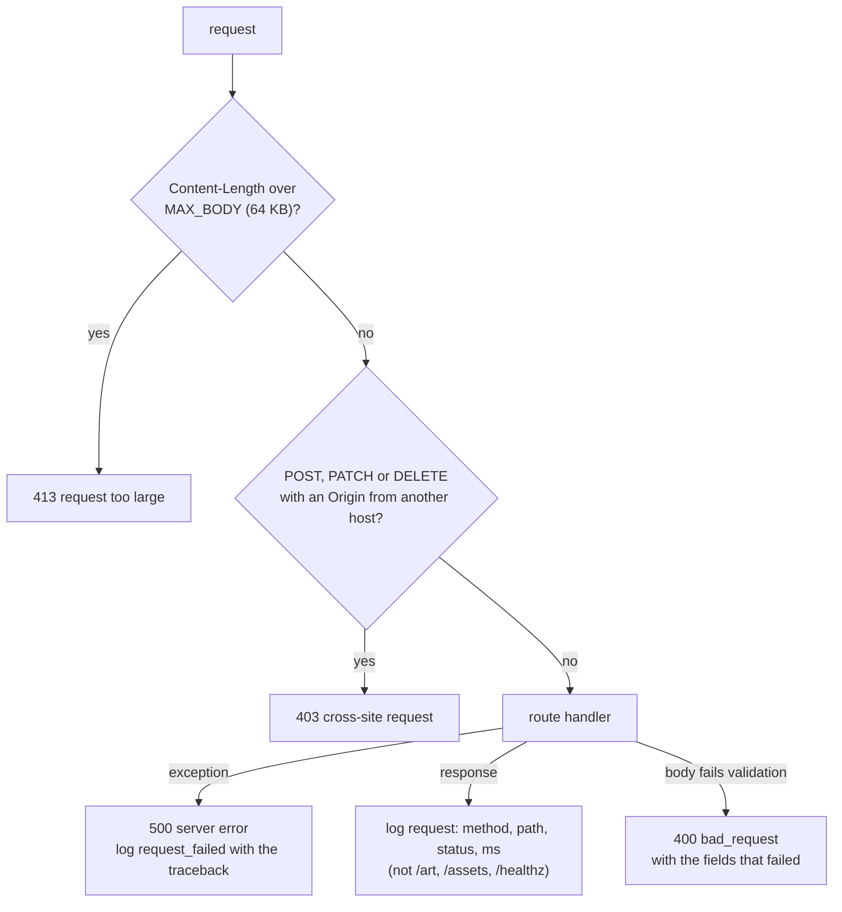

JSON errors from the API are `{"error": code, "detail": message}`. Codes: `bad_request` (400),
`bad_deck` (400), `signed_out` (401), `not_found` (404), `no_game` (404), `busy` (503), and a
`409` with the current state for a stale move.

## Routes

| Method and path | Who | What it does | Errors |
|---|---|---|---|
| `GET /api/me` | anyone | The signed-in user, the sign-in method (`google`, `dev` or none) and the current game | |
| `GET /api/options` | anyone | Decks (with Leader, colors, art, coverage), house bots (with rating from the analysis), house and default deck | |
| `GET /api/cards` | anyone | The whole card pool for the deck builder, built on first request and cached (`max-age=3600`) | |
| `GET /api/deck?name=` | anyone | A site deck's Leader and card counts | 404 `not_found` |
| `GET /decks` | anyone | Deck names, house deck and house bot names, for bot authors | |
| `GET /api/analysis` | anyone | `analysis.json`, the house bots' records from the database, and the bot list | |
| `GET /api/docs/bot-api` | anyone | `docs/bot-api.md` as text | |
| `POST /api/games` | anyone | Start a browser game | 400 `bad_request`, 400 `bad_deck`, 503 `busy` |
| `GET /game` | room owner | The table page with the game's data | 303 to `/play` without a game |
| `GET /api/state?from=N` | room owner | Frames from N on, `over`, `winner`, `turns`, `first` | 404 `no_game` |
| `POST /api/act` | room owner | Answer the decision in frame `frame` with `option` | 404 `no_game`, 409 stale, 400 |
| `POST /api/concede` | room owner | Concede; returns the final state | 404 `no_game` |
| `POST /api/new` | room owner | Same decks and bot, new game | 404 `no_game` |
| `GET /login`, `GET /auth/google` | anyone | Google sign-in | redirects to `/signin?failed=1` |
| `GET /login/dev?name=` | anyone, only with `OPTCG_DEV_LOGIN=1` | Sign in without Google | |
| `POST /logout`, `POST /api/logout` | anyone | Forget `uid` | |
| `GET`, `PATCH`, `DELETE /api/account` | signed in | Account with game history; rename; delete everything | 401 `signed_out`, 400 |
| `GET`, `POST /api/bots` | signed in | List bots, keys and matches; register a bot | 401, 400 |
| `DELETE /api/bots/{id}` | owner | Retire a bot (its keys stop working) | 401, 404 |
| `POST /api/bots/{id}/keys` | owner | A new API key, shown once | 401, 404 |
| `DELETE /api/keys/{id}` | owner | Revoke a key | 401, 404 |
| `WS /api/bot/v1/play` | API key | Play a match (below) | close codes 4400, 4401, 4429 |
| `GET /matches/{id}` | anyone with the id | A bot match's replay on the table | 404 |
| `GET /art/{path}` | anyone | Card art from `StreamingAssets/`, only when art is local | 404 |
| `GET /assets/{path}` | anyone | The built site's hashed files, cached for a year | 404 |
| `GET /healthz` | anyone | `{"ok", "games", "bot_matches"}` | |
| `GET /api/{anything else}` | anyone | | 404 `not_found` |
| `GET /{page}` | anyone | `web/dist/index.html` for the React routes; 404 page otherwise; 503 if the site isn't built | |

## Browser game

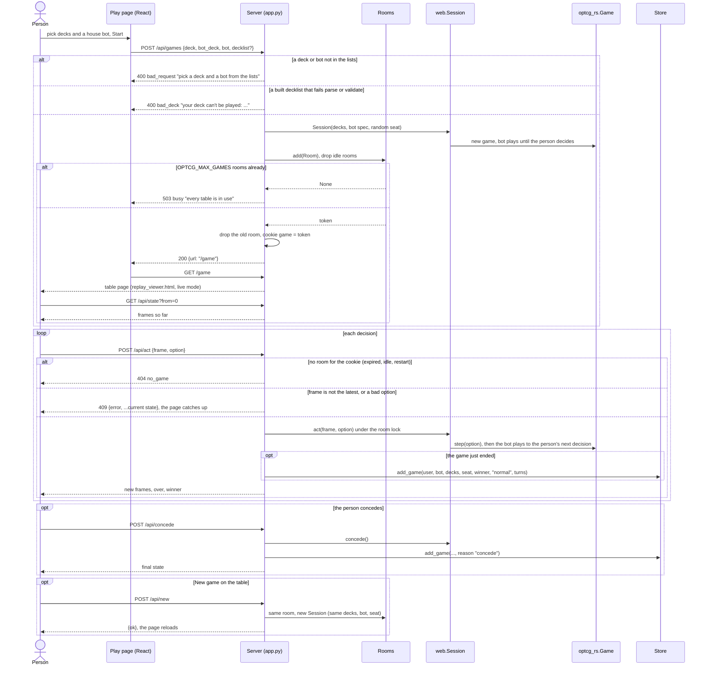

Notes:

- Guests can play; `games.user_id` is then empty. A finished game is recorded once per room
  (`Room.recorded`).
- A request for a room that has gone (restart, deploy, idle) gets `404 no_game`, and `GET /game`
  redirects to `/play`.
- The table polls nothing: every answer to `/api/act` carries the frames the bot played since,
  and the page animates them.

## Bot API match

The protocol, message by message, is in [`docs/bot-api.md`](../bot-api.md). The server side is
`botapi.py`. Close codes: `1000` normal, `4400` bad request, `4401` unauthorized, `4429` too many
matches.

### Happy path

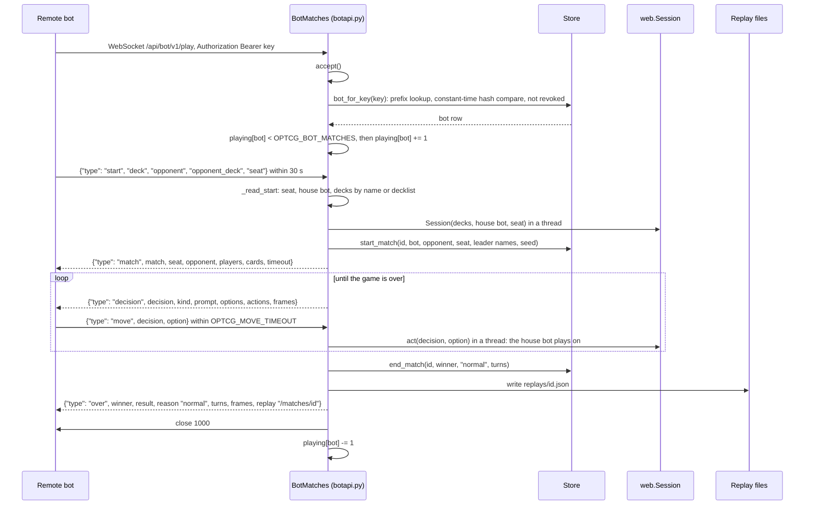

### Refused before a match starts

No match is recorded for any of these.

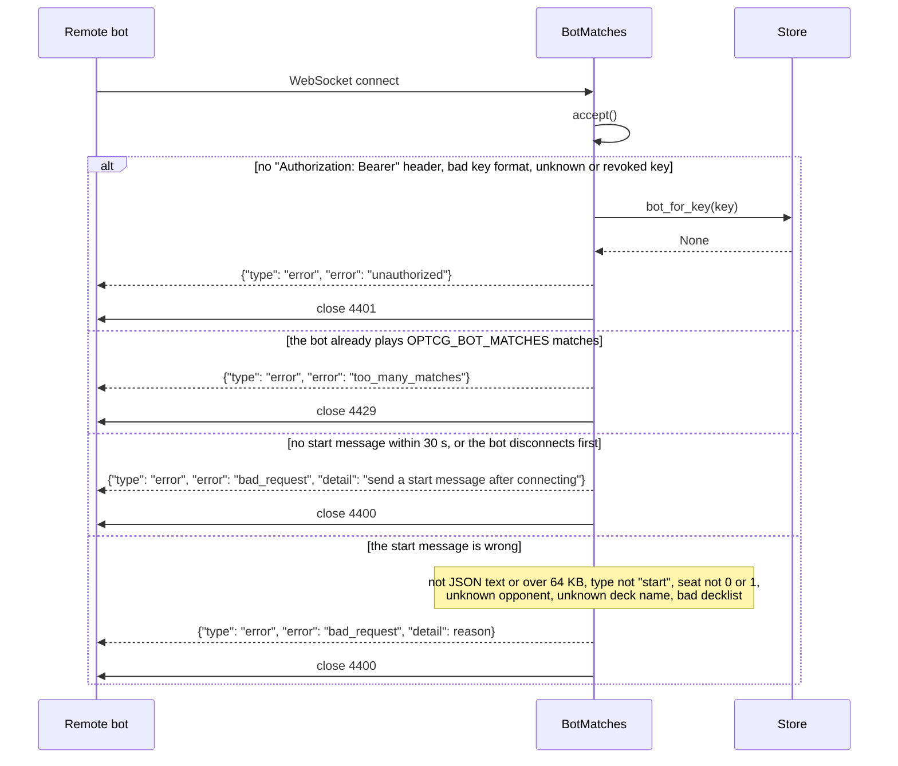

### Ending a match early: forfeits

Once a match has started, an illegal move, running out of time, conceding or disconnecting ends
it at once as a **loss for the remote bot** (`Forfeit`, then `Session.concede()`). The match is
still recorded and its replay saved, with the forfeit as `reason`.

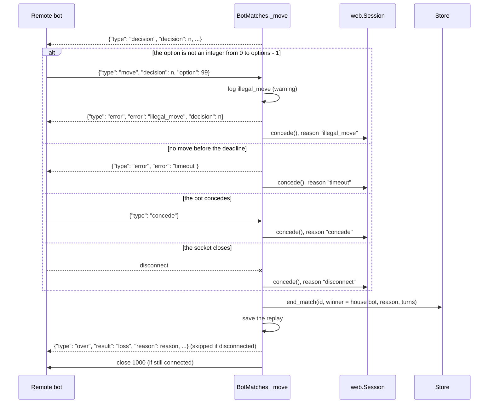

### Messages that don't end the match

These get an `error` message and the server keeps waiting. **The clock keeps running**: the
deadline is set once per decision.

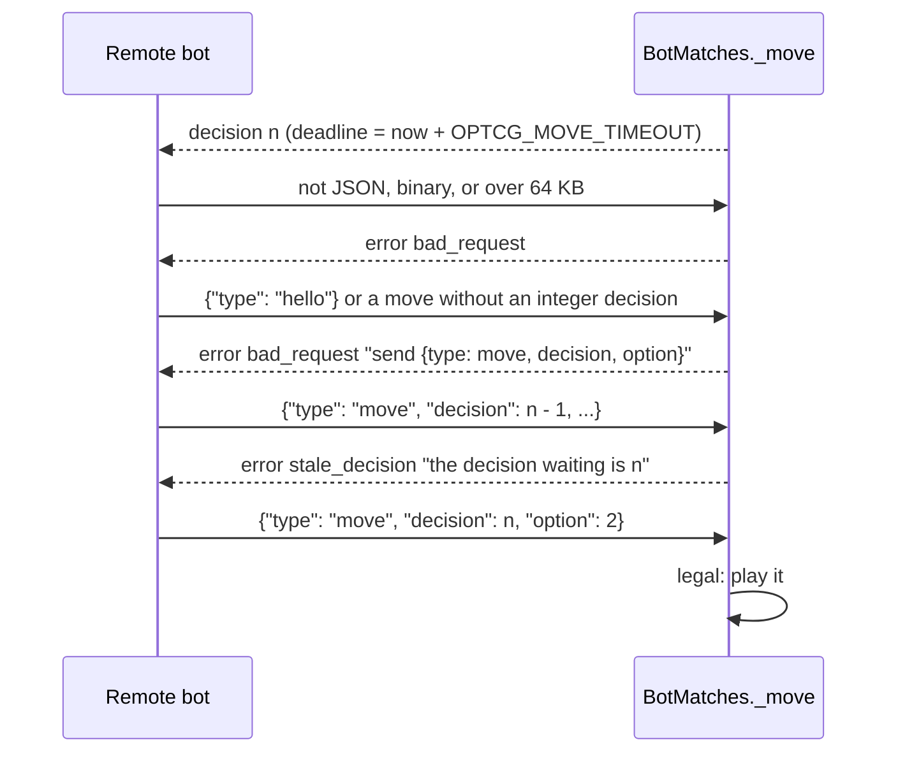

### Match states

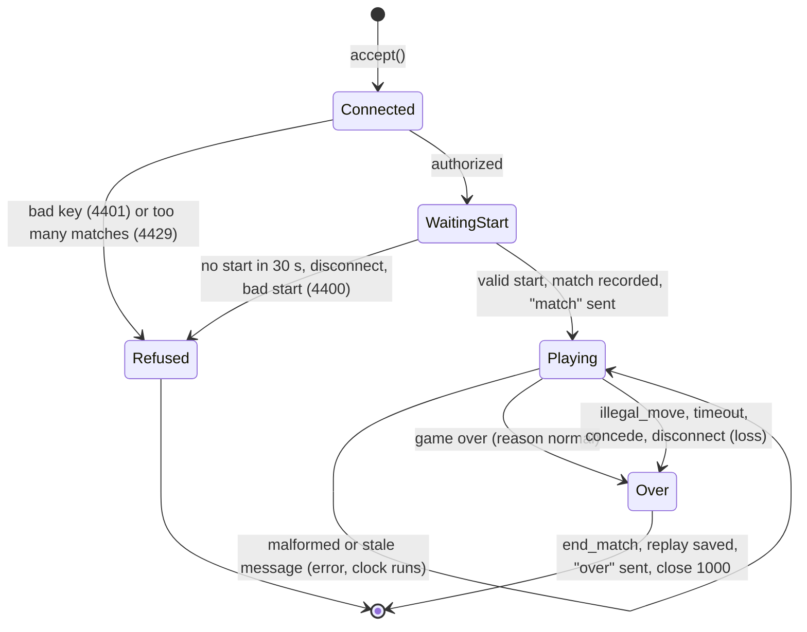

The server logs `match_start`, `illegal_move` and `match_over` (with `result`, `reason`,
`turns`, `seconds`) as JSON events.

## Signing in

Sign-in is optional: guests can play. Google is used when `GOOGLE_CLIENT_ID` and
`GOOGLE_CLIENT_SECRET` are set (Authlib, OpenID Connect, scopes `openid email profile`). The
account is keyed by Google's `sub` (stored as `google:`), which stays the same when the
person's email changes.

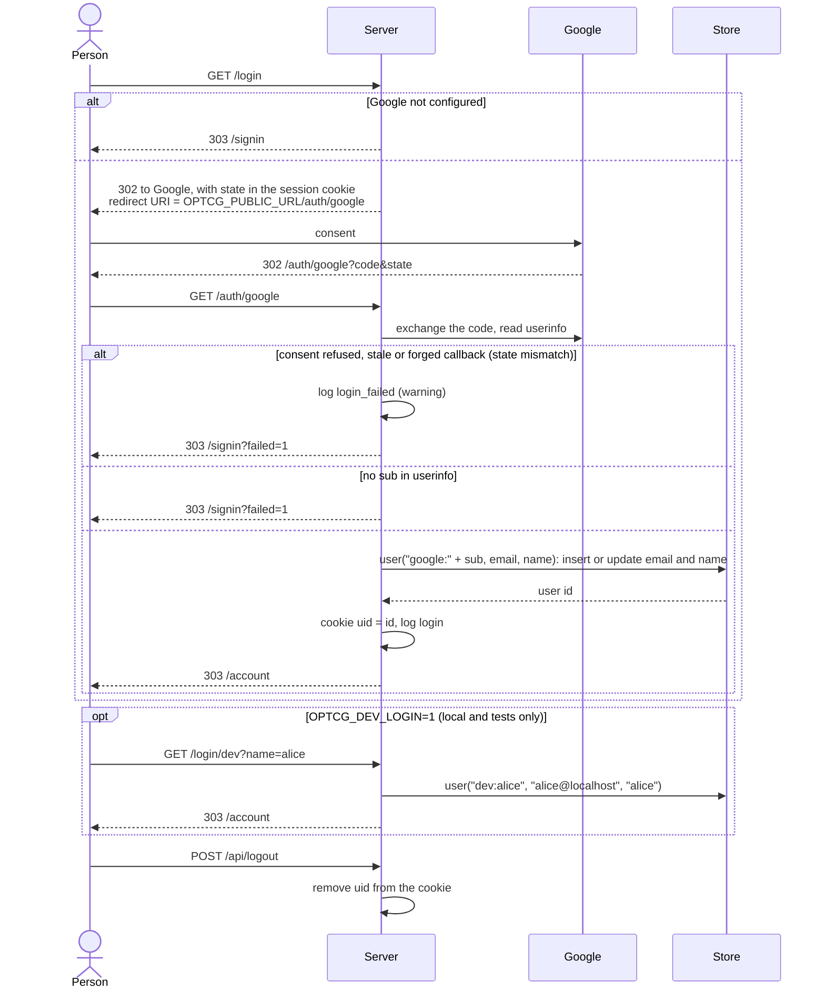

Routes that need an account answer `401 signed_out` without `uid`; the React pages then show a
sign-in prompt.

With only `OPTCG_DEV_LOGIN=1` (no Google), the site's "Sign in (dev)" buttons go to `/login`,
which redirects to `/signin`; that page then asks for a name and submits it to
`/login/dev?name=<name>`.

## Bots and API keys

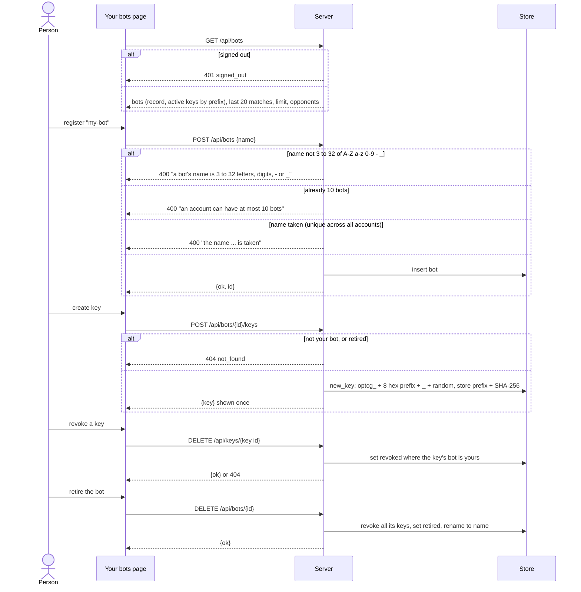

Only a key's hash is stored, so a lost key can't be shown again; make a new one. A retired bot's
matches stay in the records.

## Deck building

The deck builder runs in the browser and keeps decks in `localStorage`; the server only checks a
deck when a game is started with it.

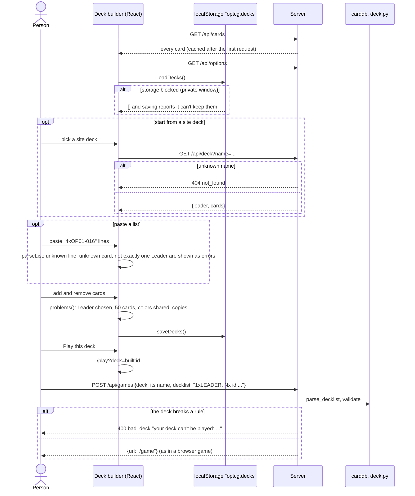

The Play page won't start with an unfinished built deck (fewer or more than 50 cards); the
server checks the deck rules again either way.

## Accounts

- `GET /api/account`: the user, totals and the last 20 browser games (`win`, `loss` or `draw`).
- `PATCH /api/account {name}`: 1 to 40 characters after trimming, else 400.
- `DELETE /api/account`: deletes the user's matches, keys, bots, games and the user, deletes the
  replay files of those matches, and clears the session.

## Configuration

Every setting is an environment variable read by `Config.from_env()`; `.env.example` has them all.
Values are never in this documentation.

| Variable | Default | Meaning |
|---|---|---|
| `OPTCG_BOTS` | `greedy` | House bots, `;`-separated, each `Name=spec` or a spec; the first is the default opponent |
| `OPTCG_DECKS` | lists in `decks/` + every official deck | Decks offered, `;`-separated names |
| `OPTCG_HOUSE_DECK` | `(Yellow) Charlotte Linlin` | The house bot's deck unless another is asked for |
| `OPTCG_DB` | `server.db` (`/data/server.db` in Docker) | SQLite file |
| `OPTCG_REPLAYS` | `replays/server` (`/data/replays` in Docker) | Bot match replays |
| `OPTCG_SECRET` | random per start | Signs the session cookie |
| `OPTCG_SECURE_COOKIES` | off (`1` in docker compose) | Cookie over HTTPS only |
| `OPTCG_PUBLIC_URL` | request URL | Where Google redirects back to |
| `GOOGLE_CLIENT_ID`, `GOOGLE_CLIENT_SECRET` | unset | Google sign-in; both needed |
| `OPTCG_DEV_LOGIN` | off | `1` enables `/login/dev`. Never on a public server |
| `OPTCG_ART_BASE` | `art` (served from `StreamingAssets/`) | Base URL for card art, e.g. a CloudFront URL |
| `OPTCG_ART_MANIFEST` | unset | File listing the art files when art is not local |
| `OPTCG_MOVE_TIMEOUT` | 30 | Seconds a remote bot gets per decision |
| `OPTCG_MAX_GAMES` | 500 | Live browser games |
| `OPTCG_IDLE_MINUTES` | 30 | Idle browser games are dropped after this |
| `OPTCG_BOT_MATCHES` | 2 | Matches one remote bot may play at once |
| `HOST`, `PORT` | `127.0.0.1`, 8000 | Where uvicorn listens |
| `OPTCG_DOMAIN` | | Used by Caddy and `deploy.sh`, not the app |
