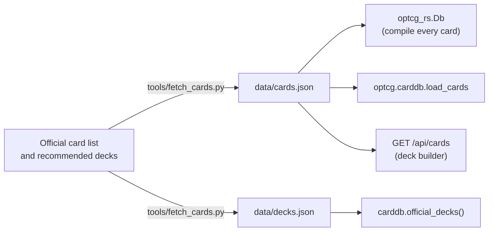
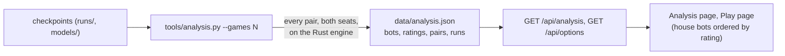
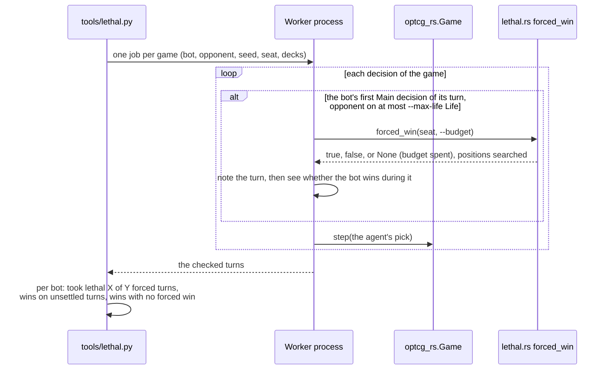

# Tools

Scripts in `tools/` and the Rust examples in `engine-rs/examples/`. Run the Python ones from the
project folder with the project's virtualenv (`.venv/bin/python tools/...`).

| Tool | What it does | Writes |
|---|---|---|
| `tools/fetch_cards.py` | Downloads the official English card list (one request per set) and the recommended decklists; skips parallel-art printings | `data/cards.json`, `data/decks.json` |
| `tools/analysis.py` | Every pair of bots plays a set of games (seats alternate, Rocks vs Linlin); Elo-style ratings are fitted to the results (Bradley-Terry, anchored on greedy at 1500), and each training run's progress is collected | `data/analysis.json`, read by the site's Analysis page and Play page |
| `tools/bench.py` | How fast the engine plays a game, which sets how long training takes | |
| `tools/bot_client.py` | A working example bot for the [bot API](../bot-api.md): connects with `OPTCG_KEY`, sends `start`, answers each `decision` with a random option, prints `error` and `over` | |
| `tools/lethal.py` | How often a bot takes lethal when it has it ([PR #4](https://github.com/LordHoboDojo/optcg-bot/pull/4), below) | optional JSON summary |
| `cargo run --release --example coverage` | Card text the Rust engine doesn't implement (`-- --list` for each line) | |
| `cargo run --release --example dump -- PREFIX` | How the second compiler read each line, for cards whose id starts with `PREFIX` | |
| `cargo run --release --example try -- "sentence"` | Which parts of a sentence the second compiler reads | |
| `cargo run --release --example fuzz` | Random games with random decks of implemented cards, looking for panics and games that never end | |
| `cargo run --release --example bench` | Speed of random games and of copying a game in progress | |

## Card data



After refreshing `data/cards.json`, run `cargo run --release --example coverage` to see whether
any new card text isn't implemented yet.

## Bot analysis



The server matches a house bot to its rating by the SHA-256 of its checkpoint file, so a
renamed file keeps its rating. Refresh and commit `data/analysis.json` after training new
checkpoints.

## Lethal checker (PR #4)

> `tools/lethal.py` and `engine-rs/src/lethal.rs` are in
> [PR #4](https://github.com/LordHoboDojo/optcg-bot/pull/4) (branch `lethal-checker`), not yet on
> `main`. The search itself is described in [Rust engine](engine.md#lethal-search-lethalrs).

It measures how often a bot finds a win that is there to be taken: of the turns where the bot
had a forced win, how many did it win?

```bash
.venv/bin/python tools/lethal.py runs/selfplay/best.pt models/house.pt greedy --games 200
.venv/bin/python tools/lethal.py runs/selfplay/best.pt --show 5    # print missed turns
```



Options: `--vs` (the opponent, default `greedy`), `--games` (per bot; seats and deck pairings
alternate), `--max-life` (default 2), `--budget` (positions per search, default 20,000),
`--workers`, `--seed`, `--show N` (print N missed turns with their log), `--json` (write the
summary).

"Forced" is against the cards actually there: the search sees the opponent's hand and the deck
order, so a bot that holds back for fear of a counter the opponent doesn't have counts as missing
lethal.
